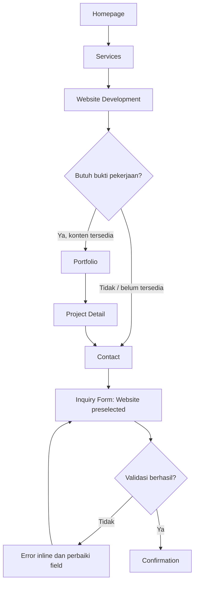
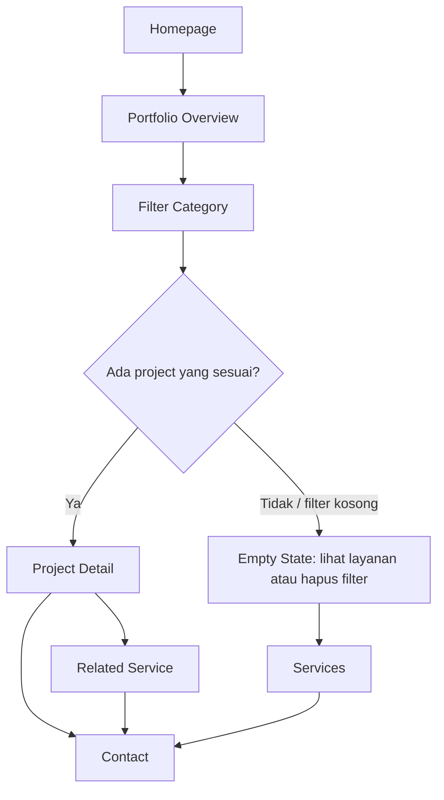
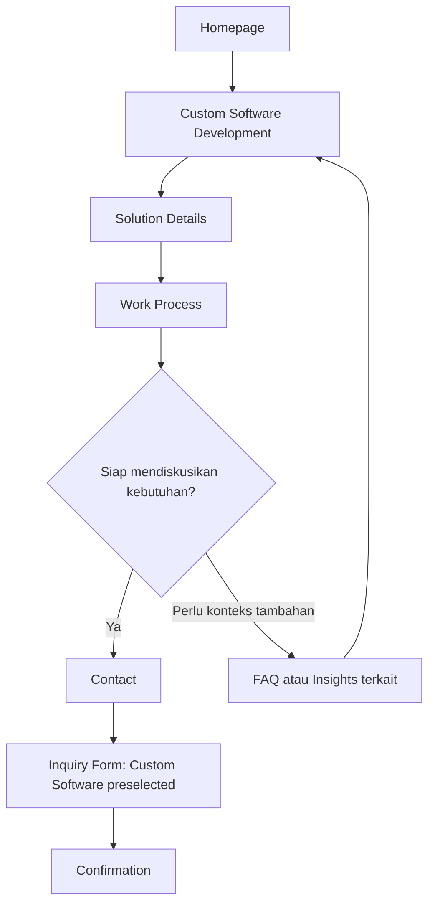
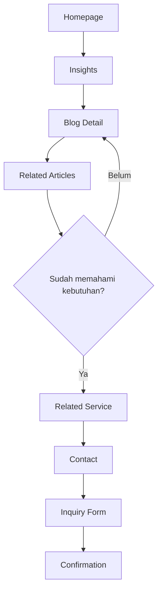

# User Flow — Techpedia Project

## Prinsip Alur

Setiap alur membawa pengguna dari pemahaman masalah menuju **Project Inquiry** dengan pilihan yang sedikit, konteks yang cukup, dan CTA yang konsisten. Jalur alternatif selalu tersedia melalui header, breadcrumbs, dan CTA ke Contact; pengguna tidak boleh terjebak pada satu halaman.

## Flow A — Website Inquiry

**Tujuan pengguna:** memahami kecocokan layanan website dan mengirim kebutuhan awal.

**CTA:** Hero Home → `Lihat Layanan Kami`; Service Detail → `Diskusikan Project Website Anda`; Portfolio/Project Detail → `Diskusikan Project Anda`; Contact → `Kirim Inquiry`.

## Flow B — Portfolio Exploration

**Tujuan pengguna:** mengevaluasi relevansi contoh pekerjaan sebelum menghubungi.

**Aturan:** Filter tidak boleh menyembunyikan seluruh nilai halaman. Jika belum ada portofolio yang valid, tampilkan pendekatan kerja dan jalur ke Services, bukan kartu proyek rekaan.

## Flow C — Custom Software Inquiry

**Tujuan pengguna:** memastikan kebutuhan software kustom layak dibahas dan menyampaikan konteks proses bisnis.

**Solution Details** menjelaskan masalah, ruang lingkup, dan deliverables secara umum. **Work Process** menjelaskan tahapan discovery sampai pengembangan tanpa mencantumkan durasi, SLA, atau metode yang belum dikonfirmasi.

## Flow D — Blog Discovery

**Tujuan pengguna:** memperoleh jawaban atas pertanyaan digital lalu menemukan layanan yang relevan.

Related Articles mendukung pembelajaran, sedangkan Related Service menjembatani intent informasional ke intent komersial. Keduanya harus kontekstual dan tidak dipaksakan.

## Pola Navigasi & CTA Lintas Flow

| Konteks | Perilaku pengguna | Rekomendasi UX | CTA utama |
| --- | --- | --- | --- |
| Pengunjung baru | Memindai manfaat dan kategori solusi. | CTA hero mengarah ke Services; header Contact selalu mudah ditemukan. | Konsultasikan Kebutuhan Anda |
| Membandingkan layanan | Membuka beberapa layanan dan kembali ke daftar. | Breadcrumb, card layanan, tautan layanan terkait. | Lihat Detail Layanan |
| Mengevaluasi kredibilitas | Mencari proses, FAQ, contoh pekerjaan. | Tautkan ke About, FAQ, dan Portfolio valid; jangan membuat bukti fiktif. | Diskusikan Project Anda |
| Siap kontak | Ingin mengirim informasi tanpa hambatan. | Service yang dipilih terbawa ke form, field ringkas, privacy notice. | Kirim Inquiry |
| Belum siap | Ingin belajar lebih lanjut. | CTA sekunder menuju Insights/FAQ, bukan memaksa form. | Pelajari Lebih Lanjut |
