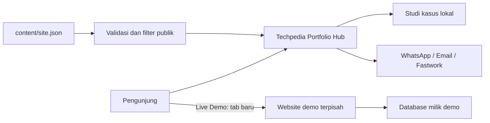

# Techpedia: Portfolio Hub + Live Project Demo

## Keputusan terbaru

Techpedia Project dipertahankan sebagai brand dengan posisi hybrid: developer portfolio dan digital services. Website utama berisi profil, layanan, daftar proyek/studi kasus dan kontak langsung. Demo proyek tinggal di URL masing-masing; setiap demo boleh memiliki stack, hosting, akun dummy dan databasenya sendiri.

Tidak ada hubungan database antara Hub dan demo. Ketersediaan demo tidak menentukan kemampuan Hub menampilkan studi kasus. Halaman Contact pada mode utama tidak mengirim data ke Laravel: pengunjung memilih WhatsApp, email atau Fastwork.

## Implementasi

- `frontend/`: website statis yang sudah dapat dibangun/divalidasi tanpa paket npm; satu request JSON lokal untuk konten. Tidak memerlukan Laravel, CMS, autentikasi, database atau form-order internal.
- `content/site.json`: source yang diedit pemilik. Builder menerbitkan hanya proyek/artikel published dan approved; hasil publik di frontend/content/site.json.
- `frontend-next/`: source React/Next.js/Tailwind menggunakan data publik yang sama. Default static export, generateStaticParams, gambar statis dan kontak langsung. Build React belum dapat diverifikasi karena npm EACCES.
- `backend/`: implementasi Laravel sebelumnya tetap tersedia untuk kebutuhan lain/opsional. Halaman utama yang disajikan Laravel juga dapat membaca file JSON publik. Mode API lama masih tersedia secara eksplisit untuk kompatibilitas; bukan ketergantungan Hub.

Panduan teknis: [Next.js static export](https://nextjs.org/docs/app/guides/static-exports), [Cloudflare Pages _headers](https://developers.cloudflare.com/pages/configuration/headers/). Hasil statis menggunakan _headers; konfigurasi header source bukan bukti bahwa edge hosting sudah diuji. Tidak ada paket hosting yang dibeli atau akun/proyek hosting yang dibuat.

## Dampak terhadap Phase 5

Laporan Phase 5 sebelumnya merupakan baseline arsitektur CMS/backend. Permintaan terbaru mengganti kebutuhan website utama menjadi hub statis: dashboard/role/database tidak diperlukan untuk fungsi inti Hub. Baseline lama tidak diubah menjadi PASS secara retroaktif. Validasi lingkup baru dicatat terpisah di VALIDATION-REPORT.md. Ini tidak memberikan persetujuan Phase 6 atau membuktikan build React/SEO produksi sudah selesai.
